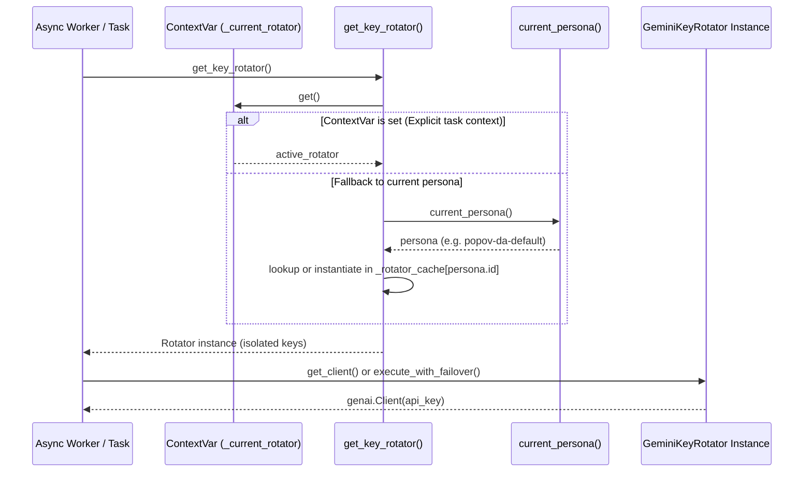
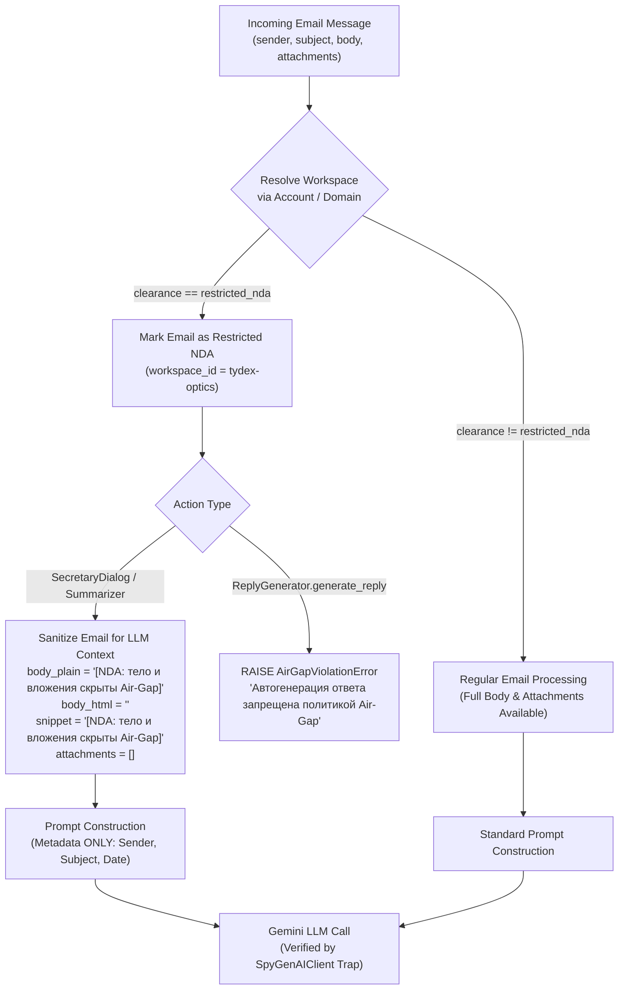
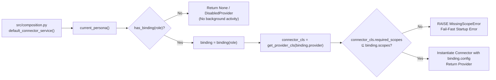

# Phase 06: Готовность к мультитенантности - Research

**Phase Target:** Полная готовность платформы к мультитенантности (изоляция нескольких персон в одном процессе), строгий внутренний Air-Gap для корпоративных данных и доведение проекта до финальной метрики завершения с чистым сканером хардкода (`HARDCODE_BASELINE = {}`).
**Requirements Covered:** `ISO-01`, `ISO-02`, `ISO-03`, `ISO-04`, `FIN-01`.

---

## 1. Executive Summary & Architectural Overview

Phase 06 переводит Antigravity Studio & Assistant Core на уровень полной готовности к мультитенантности (multi-tenant readiness) в рамках единого асинхронного процесса. 

Ключевые архитектурные задачи фазы:
1. **Изоляция LLM-контекста и ключей (ISO-01):** Ликвидация мутации глобального состояния (`config.GEMINI_API_KEY = active_key`) в пользу связки `ContextVar` + фабрика ротатора `get_key_rotator(persona_id)`. Пул ключей персоны загружается из `persona.gemini_keys` с fallback на окружение.
2. **Внутренний Air-Gap для корпоративных данных (ISO-02):** Декларативное сопоставление входящих писем (`EmailMessage`) и контекста с рабочими пространствами уровня `restricted_nda`. Полное вырезание `body_plain`, `body_html`, `snippet` и вложений перед передачей в любые LLM-вызовы (`SecretaryDialog`, `Summarizer`) с подстановкой метки `«[NDA: тело и вложения скрыты Air-Gap]»`. Полная блокировка генерации автоответов (`ReplyGenerator`) с ошибкой `AirGapViolationError`. Верификация через тестовую ловушку `SpyGenAIClient`.
3. **Zero-Trust Scopes коннекторов (ISO-03):** Декларация `required_scopes: ClassVar[tuple[str, ...]]` в портах/коннекторах, fail-fast валидация прав в фабрике композиции `src/composition.py` (`MissingScopeError`), возврат `None`/заглушки при отсутствии привязки, и автотест `test_credentials_isolation.py` в `chat-app`, подтверждающий отсутствие учетных данных LMS в процессе веб-студии.
4. **Конкурентная изоляция персон (ISO-04):** Сквозной интеграционный тест, одновременно исполняющий задачи для `popov-da-default` и `synthetic-test-persona` в рамках одного процесса (`asyncio.gather`), доказывающий отсутствие cross-talk в ключах, кэшах персоны, рабочих пространствах, скоупах коннекторов и хранилище подтверждений.
5. **Ликвидация остаточного хардкода (FIN-01):** Систематическое обнуление бейзлайна хардкода (`HARDCODE_BASELINE = {}`) в обоих репозиториях в 2 этапа (боевые модули `src/` -> вспомогательные скрипты `scripts/` + перемещение `reconcile_report.json` в `docs/baseline/`), при 100% сохранении поведения по умолчанию и прохождении гейта качества.

---

## 2. Architectural Responsibility Map

```
┌────────────────────────────────────────────────────────────────────────────────────────┐
│                                    PLATFORM BOUNDARIES                                 │
├──────────────────────────────────────────┬─────────────────────────────────────────────┤
│   assistant-core (/opt/assistant-core)   │        chat-app (/opt/chat-app)             │
├──────────────────────────────────────────┼─────────────────────────────────────────────┤
│ [ISO-01] Brain & Key Isolation           │ [ISO-03] Credentials Isolation              │
│ - src/brain/key_rotator.py               │ - backend/tests/test_credentials_isolation.py│
│   (ContextVar, get_key_rotator, no env)  │ - backend/app/core/config.py (zero LMS)     │
│ - src/persona/models.py                  ├─────────────────────────────────────────────┤
│   (gemini_keys field in PersonaConfig)   │ [FIN-01] Hardcode Elimination (Web)         │
├──────────────────────────────────────────┤ - backend/app/db.py (rasp_% query)          │
│ [ISO-02] Air-Gap & LLM Shield            │ - scripts/notion_dev.py (parameterize)      │
│ - src/core/domain/entities.py            │ - scripts/run_daedalus.sh (clean prompt)    │
│   (EmailMessage.workspace_id)            │ - backend/tests/hardcode_baseline.py -> {}  │
│ - src/brain/reply_generator.py           ├─────────────────────────────────────────────┤
│   (AirGapViolationError on NDA)          │ [SHARED CONTRACTS / SYNCED FILES]           │
│ - src/brain/secretary_dialog.py          │ - backend/tests/synthetic_persona.py <─┐    │
│   (masking NDA emails in overview/search)│ - tests/synthetic_persona.py         <─┴─┐  │
│ - src/brain/summarizer.py                │   (100% SHA-256 parity in gate)          │  │
│   (masking NDA emails in briefs/digests) │ - backend/tests/persona_tokens.py    <─┐ │  │
│ - tests/test_airgap_trap.py              │ - tests/persona_tokens.py            <─┴─┘  │
│   (SpyGenAIClient trap test)             │   (100% SHA-256 parity in gate)             │
├──────────────────────────────────────────┴─────────────────────────────────────────────┤
│ [ISO-03] Zero-Trust Connector Scopes (assistant-core)                                  │
│ - src/core/ports/connectors.py (required_scopes ClassVar on ports)                     │
│ - src/connectors/*/provider.py (required_scopes on providers)                          │
│ - src/composition.py (scope validation & MissingScopeError)                            │
├────────────────────────────────────────────────────────────────────────────────────────┤
│ [ISO-04] Concurrent Multi-Tenant Verification                                          │
│ - tests/test_concurrency_isolation.py (concurrent execution of default vs synthetic)  │
├────────────────────────────────────────────────────────────────────────────────────────┤
│ [FIN-01] Hardcode Elimination (Daemon)                                                 │
│ - src/ (22 files): replace tokens with current_persona() calls                         │
│ - scripts/ (11 files): argparse / current_persona() parameterization                   │
│ - reconcile_report.json -> move to docs/baseline/                                      │
│ - tests/hardcode_baseline.py -> HARDCODE_BASELINE = {}                                 │
└────────────────────────────────────────────────────────────────────────────────────────┘
```

---

## 3. User Constraints (from CONTEXT.md)

| ID | Constraint | Description | Reversibility |
|---|---|---|---|
| **D-01** | `ContextVar` + factory `get_key_rotator(persona_id)` | `GeminiKeyRotator` изолируется через `ContextVar` и фабрику. Контекст вызова изолирован на уровне асинхронного таска, исключая cross-talk и race conditions параллельных персон. | costly |
| **D-02** | Remove global mutation | Полностью удаляется строка `config.GEMINI_API_KEY = active_key`. Компоненты получают `genai.Client` исключительно через ротатор или контекстную переменную. | costly |
| **D-03** | Opt-in env persistence | Метод `sync_active_key_to_env` выполняет запись в `.env` только при явной передаче аргумента `env_path` (для 100% совместимости с `test_key_rotator.py`). В боевом режиме (`env_path=None`) запись на диск отключена. | reversible |
| **D-04** | Persona keys fallback | Пул ключей для персоны считывается из профиля персоны (`persona.gemini_keys`), а при их отсутствии — fallback на системные переменные окружения `GEMINI_API_KEYS` / `GEMINI_API_KEY`. | reversible |
| **D-05** | Declarative email mapping | Сопоставление входящих писем (`EmailMessage`) с рабочими пространствами выполняется декларативно по привязке `account_id` или доменов отправителей/получателей к `workspace_id` персоны с уровнем допуска `restricted_nda`. | costly |
| **D-06** | Masking NDA content for LLM | При попадании письма из `restricted_nda` в выборку диалога или сводки (`SecretaryDialog`, `Summarizer`), в LLM передаются только обезличенные метаданные: Отправитель, Тема, Дата с пометкой `«[NDA: тело и вложения скрыты Air-Gap]»`. Поля `body_plain`, `body_html`, `snippet` и вложения полностью вырезаются. | costly |
| **D-07** | Blocking reply generation | Попытка генерации автоответа в `ReplyGenerator` для письма из `restricted_nda` блокируется с возбуждением исключения `AirGapViolationError` и возвратом статуса «Автогенерация ответа запрещена политикой Air-Gap». | costly |
| **D-08** | LLM Spy Trap test | Mock/Spy клиент `genai.Client`, перехватывающий все prompts/contents и проверяющий строгим assert полное отсутствие фрагментов тел, сниппетов, вложений и NDA-токенов при любых сценариях обработки почты `restricted_nda`. | reversible |
| **D-09** | ClassVar required_scopes | Коннекторы объявляют требуемые разрешения через атрибут класса `required_scopes: ClassVar[tuple[str, ...]]` в базовых портах. | costly |
| **D-10** | Fail-fast scope validation | Валидация скоупов производится в фабрике композиции (`src/composition.py`): сверка `binding.scopes` персоны с `connector.required_scopes`. При нехватке выбрасывается `MissingScopeError`. | costly |
| **D-11** | Unbound role returns None | Если у персоны нет привязки для определенной роли коннектора, коннектор не создается (возвращается `None` или заглушка `DisabledProvider`), предотвращая фоновую активность. | reversible |
| **D-12** | LMS Credentials Isolation | Изоляция учетных данных LMS в `chat-app` подтверждается автотестом `backend/tests/test_credentials_isolation.py`: инспекция настроек `Settings`, `os.environ` и роутеров на полное отсутствие полей `PRO_GUAP_*` и `LMS_*`. | reversible |
| **D-13** | Dynamic lookup in src/ | В боевых модулях `src/` (22 файла) специфичные строковые литералы заменяются на динамические данные из `current_persona()` (`ui.texts`, `workspaces`, `persona.name`). | costly |
| **D-14** | CLI parameterization in scripts/ | Вспомогательные скрипты в `scripts/` параметризуются через аргументы CLI (`argparse`) или считывают конфигурацию из `current_persona()`. | reversible |
| **D-15** | Move reconcile_report.json | Исторический артефакт `reconcile_report.json` в корне репозитория перемещается в `docs/baseline/`, исключаясь из корня сканирования. | reversible |
| **D-16** | Two-step hardcode elimination | 1. Очистка ядра `src/` с контролем неизменности поведения через тесты 1:1. 2. Параметризация `scripts/` и обнуление `HARDCODE_BASELINE = {}`. | reversible |

---

## 4. Architecture Patterns & Sequence Flows

### 4.1. Gemini Key Rotator Isolation (ISO-01)

В текущей кодовой базе `key_rotator = GeminiKeyRotator()` является глобальным синглтоном, который при ротации вызывает `config.GEMINI_API_KEY = active_key`.
В целевой архитектуре:
- Вводится `_current_rotator: ContextVar[GeminiKeyRotator | None] = ContextVar("current_rotator", default=None)`.
- Фабрика `get_key_rotator(persona_id: str | None = None) -> GeminiKeyRotator`:
  1. Если в текущем контексте `_current_rotator.get()` установлен — возвращает его.
  2. Иначе определяет целевую персону (`persona = current_persona()`).
  3. Проверяет внутренний кэш ротаторов персон `_rotator_cache: dict[str, GeminiKeyRotator]`.
  4. Если нет — создает `GeminiKeyRotator(keys=persona.gemini_keys or config.GEMINI_API_KEYS, env_path=None)`.
- Глобальная переменная `key_rotator` в `key_rotator.py` превращается в динамический прокси или экземпляр-делегат, вызывающий `get_key_rotator()`, что обеспечивает 100% обратную совместимость для существующих импортов.



### 4.2. NDA Air-Gap Email Processing Flow (ISO-02)



### 4.3. Zero-Trust Connector Composition (ISO-03)



---

## 5. Standard Stack & Available Tools

- **Language & Runtime:** Python 3.12 (typing annotations, `StrEnum`, `dataclasses`, `slots=True`).
- **Context Isolation:** `contextvars.ContextVar`, `contextvars.copy_context` (Standard Library).
- **Asynchronous Execution:** `asyncio.gather`, `asyncio.create_task`, `asyncio.Lock` (Standard Library).
- **Configuration & Validation:** `pydantic` v2 (в `PersonaConfig`), `PyYAML` (в `assistant-core`).
- **LLM SDK:** `google.genai` (official Google GenAI SDK, cached client per API key).
- **Quality Gates & Linters:** `scripts/gate.py`, `import-linter`, `scripts/security_shield.py`.
- **Testing:** `pytest`, `pytest-asyncio`, `unittest.mock.MagicMock`, `unittest.mock.AsyncMock`.

---

## 6. What NOT to Hand-Roll (Don't Hand-Roll List)

1. **НЕ писать собственную замену `ContextVar` на потоках или глобальных словарях:**
   `contextvars` — стандартный и единственно надежный механизм изоляции контекста в асинхронных корутинах Python. При создании `asyncio.Task` контекст автоматически наследуется, но изменения внутри задачи изолируются от родительской и соседних задач.
2. **НЕ изобретать сложный AST-парсер для проверки утечек данных:**
   Вместо сложного синтаксического анализа промптов используется паттерн `SpyGenAIClient` (шпион клиента SDK), который перехватывает строковые аргументы `contents` и `system_instruction` в вызове `generate_content` и выполняет проверку `assert nda_token not in prompt`.
3. **НЕ хардкодить списки запрещенных слов в логику фильтрации писем:**
   Все правила фильтрации должны считываться из полей `workspace.forbidden_keywords`, `workspace.forbidden_remote_substrings` и конфигурации организации персоны.
4. **НЕ изменять эталоны промптов Фазы 3:**
   Шаблоны промптов в `prompts/*.jinja2` зафиксированы золотыми тестами. Ликвидация хардкода касается исключительно кода Python в `src/` и `scripts/`, где статические литералы заменяются обращениями к `current_persona()`.

---

## 7. Common Pitfalls & Landmines

### Pitfall 1: Parity Drift in Synced Files (Gate Failure)
**Risk:** Файлы `synthetic_persona.py` и `persona_tokens.py` имеют по две независимые копии: в `backend/tests/` (chat-app) и `tests/` (assistant-core). Скрипт `scripts/gate.py` на каждом запуске проверяет их SHA-256 хеши.
**Prevention:** Любая модификация синтетической персоны или токенов должна производиться строго одновременно в обоих файлах.

### Pitfall 2: `test_key_rotator.py` Regression on Disk Sync
**Risk:** Текущий тест `test_key_rotator.py` явно проверяет, что при вызове `mark_exhausted()` файл `.env` обновляется:
```python
env_content = temp_env_file.read_text()
assert f"GEMINI_API_KEY={mock_keys[1]}" in env_content
```
Если полностью отключить запись на диск, существующие тесты упадут.
**Prevention:** В `GeminiKeyRotator.__init__` параметр `env_path` по умолчанию должен быть `None`. В методе `sync_active_key_to_env` запись выполняется только если `self.env_path is not None`. Фикстура `test_key_rotator.py` передает `env_path=temp_env_file`, поэтому тесты остаются 100% зелеными, а в боевом коде запись на диск не происходит.

### Pitfall 3: Scanner Stale Entries Detection
**Risk:** Сканер хардкода `test_hardcode_scanner.py` проверяет не только отсутствие новых токенов (`new`), но и отсутствие завышенных чисел в бейзлайне (`stale`):
```python
if found.get((path, cls), 0) < count:  # stale!
```
Если вычистить хардкод из файла, но не обновить `HARDCODE_BASELINE`, тест упадет с ошибкой «baseline больше фактического счёта, его нужно сократить».
**Prevention:** Обновление `HARDCODE_BASELINE` в `hardcode_baseline.py` должно происходить синхронно с очисткой модулей либо в рамках единого коммита шага.

### Pitfall 4: `reconcile_report.json` in Repo Root
**Risk:** Файл `reconcile_report.json` в корне `assistant-core` генерирует 23 вхождения хардкода (`name`: 22, `organization`: 1). Так как расширение `.json` сканируется, он красит сканер.
**Prevention:** Переместить файл в `docs/baseline/reconcile_report.json` согласно D-15. Префикс `docs/` входит в `ALLOWLIST_PREFIXES`, поэтому сканер автоматически его проигнорирует.

### Pitfall 5: Async Context Leakage in Concurrency Tests
**Risk:** При параллельном запуске корутин через `asyncio.gather(*tasks)` без явной изоляции контекста или при использовании глобальных переменных изменения персоны одной корутиной могут повлиять на другую.
**Prevention:** Использовать `use_persona()` внутри тела корутины каждого отдельного воркера либо передавать скопированный контекст (`contextvars.copy_context().run(...)`).

---

## 8. Detailed Blueprints by Requirement

### 8.1. ISO-01: Gemini Key Rotator & Session Isolation

**Target file:** `/opt/assistant-core/src/brain/key_rotator.py`
**Configuration model:** `/opt/assistant-core/src/persona/models.py`

#### Implementation Blueprint:
1. В `src/persona/models.py` добавить в `PersonaConfig`:
   ```python
   gemini_keys: list[str] = Field(default_factory=list)
   ```
2. В `src/brain/key_rotator.py`:
   - Добавить исключение строки `config.GEMINI_API_KEY = active_key`.
   - Изменить конструктор `GeminiKeyRotator`:
     ```python
     def __init__(
         self,
         keys: list[str] | None = None,
         env_path: Path | None = None,
     ) -> None:
         raw_keys = keys or config.GEMINI_API_KEYS
         self.keys: list[str] = []
         for k in raw_keys:
             clean = k.strip()
             if clean and clean not in self.keys:
                 self.keys.append(clean)
         if not self.keys and config.GEMINI_API_KEY:
             self.keys = [config.GEMINI_API_KEY.strip()]
         
         # Opt-in disk sync: None by default in production
         self.env_path = env_path
         self.cooldowns: dict[str, float] = {}
         self._clients: dict[str, genai.Client] = {}
         self.active_index: int = 0
         self._lock = asyncio.Lock()
     ```
   - В `sync_active_key_to_env`:
     ```python
     def sync_active_key_to_env(self, active_key: str) -> bool:
         """Atomically update GEMINI_API_KEY in .env file ONLY if env_path was explicitly provided."""
         if not self.env_path or not self.env_path.exists():
             return False
         try:
             content = self.env_path.read_text(encoding="utf-8")
             pattern = r"^GEMINI_API_KEY=.*$"
             if re.search(pattern, content, flags=re.MULTILINE):
                 new_content = re.sub(pattern, f"GEMINI_API_KEY={active_key}", content, flags=re.MULTILINE)
             else:
                 new_content = content.rstrip() + f"\nGEMINI_API_KEY={active_key}\n"
             tmp_path = self.env_path.with_suffix(".tmp")
             tmp_path.write_text(new_content, encoding="utf-8")
             tmp_path.replace(self.env_path)
             # NOTE: config.GEMINI_API_KEY = active_key REMOVED (D-02)
             return True
         except Exception as e:
             logger.warning("Could not persist active Gemini API key: %s", e)
             return False
     ```
   - Добавить изоляцию контекста и фабрику:
     ```python
     _rotator_cache: dict[str, GeminiKeyRotator] = {}
     _current_rotator: ContextVar[GeminiKeyRotator | None] = ContextVar("current_key_rotator", default=None)

     def get_key_rotator(persona_id: str | None = None) -> GeminiKeyRotator:
         """Returns active rotator from ContextVar, or persona-cached instance, or default."""
         ctx_rotator = _current_rotator.get()
         if ctx_rotator is not None:
             return ctx_rotator

         from src.persona.current import current_persona
         persona = current_persona()
         p_id = persona_id or persona.id

         if p_id not in _rotator_cache:
             keys = getattr(persona, "gemini_keys", None) or config.GEMINI_API_KEYS
             _rotator_cache[p_id] = GeminiKeyRotator(keys=keys, env_path=None)

         return _rotator_cache[p_id]

     class _KeyRotatorProxy:
         """Proxy for backward compatibility with `from src.brain.key_rotator import key_rotator`."""
         def __getattr__(self, name: str) -> Any:
             return getattr(get_key_rotator(), name)

     key_rotator = _KeyRotatorProxy()
     ```

---

### 8.2. ISO-02: Air-Gap Workspace Scope & Mock LLM Trap

**Target files:**
- `/opt/assistant-core/src/core/exceptions.py` (или `src/core/domain/exceptions.py`)
- `/opt/assistant-core/src/brain/reply_generator.py`
- `/opt/assistant-core/src/brain/secretary_dialog.py`
- `/opt/assistant-core/src/brain/summarizer.py`
- `/opt/assistant-core/src/security/airgap.py` (новый модуль хелперов)
- `/opt/assistant-core/tests/test_airgap_trap.py` (тест-ловушка)

#### Implementation Blueprint:
1. Определение исключения:
   ```python
   class AirGapViolationError(RuntimeError):
       """Возбуждается при попытке передачи содержимого restricted_nda в незащищенный LLM-контур."""
       pass
   ```
2. Модуль `/opt/assistant-core/src/security/airgap.py`:
   ```python
   from typing import Any
   from src.persona.current import current_persona
   from src.core.domain.entities import WorkspaceClearance

   NDA_MASK_MARKER = "[NDA: тело и вложения скрыты Air-Gap]"

   def is_nda_email(email_data: dict[str, Any] | Any, persona: Any | None = None) -> bool:
       p = persona or current_persona()
       # 1. Direct workspace_id check
       ws_id = email_data.get("workspace_id") if isinstance(email_data, dict) else getattr(email_data, "workspace_id", None)
       if ws_id:
           for ws in p.workspaces:
               if ws.id == ws_id and ws.clearance == WorkspaceClearance.RESTRICTED_NDA:
                   return True

       # 2. Account / sender domain check against restricted_nda workspaces
       sender = (email_data.get("sender_email") if isinstance(email_data, dict) else getattr(email_data, "sender", "")) or ""
       sender_lower = sender.lower()
       for ws in p.workspaces:
           if ws.clearance == WorkspaceClearance.RESTRICTED_NDA or getattr(ws, "clearance", "") == "restricted_nda":
               # Check corporate domain or account marker
               if "@tydex.ru" in sender_lower or "tydex" in (ws.account or "").lower():
                   if "@tydex.ru" in sender_lower:
                       return True
       return False

   def mask_nda_email_data(email_data: dict[str, Any]) -> dict[str, Any]:
       sanitized = dict(email_data)
       sanitized["body_plain"] = NDA_MASK_MARKER
       sanitized["body_html"] = ""
       sanitized["snippet"] = NDA_MASK_MARKER
       sanitized["attachments"] = []
       return sanitized
   ```
3. В `src/brain/reply_generator.py`:
   ```python
   from src.security.airgap import is_nda_email, AirGapViolationError

   async def generate_reply(self, email_data: dict[str, Any], user_instructions: str | None = None) -> str:
       if is_nda_email(email_data):
           logger.warning("Reply generation blocked for restricted_nda email: %s", email_data.get("id"))
           raise AirGapViolationError("Автогенерация ответа запрещена политикой Air-Gap")
       ...
   ```
4. В `src/brain/secretary_dialog.py`:
   При выборке писем в `_get_email_overview` и `_search_email_context`:
   ```python
   for em in emails:
       if is_nda_email(em):
           em = mask_nda_email_data(em)
           snippet_text = NDA_MASK_MARKER
       else:
           snippet_text = em.get("snippet") or em.get("body_plain", "")[:150]
       lines.append(f"• [{date_str}] От: {sender} ({em.get('sender_email')})\n  Тема: «{subj}»\n  Текст: {snippet_text}")
   ```
5. В тестах (`tests/test_airgap_trap.py`):
   Класс `SpyGenAIClient`, перехватывающий `aio.models.generate_content`:
   ```python
   class SpyGenAIClient:
       def __init__(self):
           self.prompts_captured: list[str] = []
           self.system_instructions_captured: list[str] = []

       @property
       def aio(self):
           return self

       @property
       def models(self):
           return self

       async def generate_content(self, model: str, contents: Any, config: Any = None):
           prompt_str = str(contents)
           self.prompts_captured.append(prompt_str)
           if config and hasattr(config, "system_instruction"):
               self.system_instructions_captured.append(str(config.system_instruction))
           
           # Strict trap assert: no NDA markers or forbidden tokens in prompt
           for forbidden in ["SECRET_NDA_CONTENT", "mock_nda_secret_token", "mock_proprietary_token"]:
               assert forbidden not in prompt_str, f"LEAK DETECTED in prompt: {forbidden}"

           # Mock successful empty response
           resp = MagicMock()
           resp.text = "Mock response from SpyGenAIClient"
           return resp
   ```

---

### 8.3. ISO-03: Zero-Trust Scopes & LMS Credentials Isolation

**Target files:**
- `/opt/assistant-core/src/core/exceptions.py` (или `src/core/domain/exceptions.py`)
- `/opt/assistant-core/src/core/ports/connectors.py`
- `/opt/assistant-core/src/connectors/guap_lms/client.py`
- `/opt/assistant-core/src/composition.py`
- `/opt/chat-app/backend/tests/test_credentials_isolation.py` (новый автотест)

#### Implementation Blueprint:
1. Определение `MissingScopeError`:
   ```python
   class MissingScopeError(PermissionError):
       """Возбуждается при нехватке разрешений (scopes) у коннектора в привязке персоны."""
       pass
   ```
2. Базовые порты в `src/core/ports/connectors.py`:
   Убедиться, что `BaseConnector` содержит:
   ```python
   required_scopes: ClassVar[tuple[str, ...]]
   ```
   И конкретные порты:
   - `BaseTimesheetProvider.required_scopes = ("timesheet.read", "timesheet.write")`
   - `BaseScheduleProvider.required_scopes = ("schedule.read",)`
   - `BaseCalendarSink.required_scopes = ("calendar.read", "calendar.write")`
   - `BaseLMSProvider.required_scopes = ("lms.read", "lms.write")`
3. В `src/connectors/guap_lms/client.py`:
   ```python
   required_scopes: ClassVar[tuple[str, ...]] = ("lms.read", "lms.write")
   ```
4. В `src/composition.py`:
   ```python
   from src.core.exceptions import MissingScopeError
   from src.persona.bindings import has_binding, binding

   def default_timesheet_service(db: Any) -> BaseTimesheetProvider | None:
       if not has_binding("timesheet"):
           return None
       bound = binding("timesheet")
       from src.connectors.aadhk.provider import AadhkTimesheetProvider
       from src.connectors.aadhk.parser import AadhkIngestionService
       
       req = set(AadhkTimesheetProvider.required_scopes)
       actual = set(bound.scopes)
       if not req.issubset(actual):
           raise MissingScopeError(f"timesheet provider requires scopes {req}, persona only provided {actual}")
       return AadhkTimesheetProvider(AadhkIngestionService(db))

   def default_lms_client() -> LmsClientLike | None:
       if not has_binding("lms"):
           return None
       bound = binding("lms")
       from src.connectors.guap_lms.client import GuapLmsClient
       req = set(GuapLmsClient.required_scopes)
       actual = set(bound.scopes)
       if not req.issubset(actual):
           raise MissingScopeError(f"lms client requires scopes {req}, persona only provided {actual}")
       return GuapLmsClient()
   ```
5. В `chat-app` `/opt/chat-app/backend/tests/test_credentials_isolation.py`:
   ```python
   import os
   from app.core.config import Settings, settings
   from app.main import app

   def test_settings_has_no_lms_credentials():
       for field_name in Settings.model_fields.keys():
           low = field_name.lower()
           assert "guap" not in low and "lms" not in low, f"LMS credentials field found in Settings: {field_name}"
       for attr in dir(settings):
           low = attr.lower()
           assert not low.startswith("pro_guap_") and not low.startswith("lms_"), f"Unexpected LMS attr: {attr}"

   def test_environ_has_no_lms_credentials_in_chatapp():
       # Ensure chat-app process does not rely on or export LMS credentials
       for key in os.environ:
           assert not key.startswith("PRO_GUAP_") and not key.startswith("LMS_"), f"LMS credential leaked in env: {key}"

   def test_routes_do_not_expose_lms_endpoints():
       route_paths = [r.path for r in app.routes]
       for path in route_paths:
           assert "/lms" not in path and "/guap" not in path
   ```

---

### 8.4. ISO-04: Multi-Tenant Concurrency Verification Test

**Target file:** `/opt/assistant-core/tests/test_concurrency_isolation.py`

#### Implementation Blueprint:
Тест выполняет параллельный запуск двух воркеров (`asyncio.gather`) в рамках одного процесса:
- Воркер 1: Персона по умолчанию (`popov-da-default`).
- Воркер 2: Вторая синтетическая персона (`synthetic-test-persona`).

```python
import asyncio
import pytest
from src.persona.current import current_persona, use_persona
from src.persona.loader import load_persona
from src.brain.key_rotator import get_key_rotator
from tests.synthetic_persona import SYNTHETIC_PERSONA, synthetic_to_config
from src.composition import default_timesheet_service, default_lms_client
from src.core.exceptions import MissingScopeError

@pytest.mark.asyncio
async def test_multi_persona_concurrency_isolation(tmp_path):
    default_p = current_persona()
    synth_cfg = synthetic_to_config(SYNTHETIC_PERSONA)["persona"]
    # Instantiate Pydantic model for synthetic persona
    from src.persona.models import PersonaConfig
    synth_p = PersonaConfig.model_validate(synth_cfg)

    results_default = []
    results_synth = []

    async def worker_default():
        for i in range(10):
            p = current_persona()
            rotator = get_key_rotator()
            results_default.append((p.id, len(p.workspaces), rotator.get_active_key()))
            await asyncio.sleep(0.01)

    async def worker_synth():
        with use_persona(synth_p):
            for i in range(10):
                p = current_persona()
                rotator = get_key_rotator()
                # Verify synthetic has empty scopes for timesheet/lms -> throws MissingScopeError
                with pytest.raises(MissingScopeError):
                    default_timesheet_service(None)
                results_synth.append((p.id, len(p.workspaces), rotator.get_active_key()))
                await asyncio.sleep(0.01)

    await asyncio.gather(worker_default(), worker_synth())

    # Assert no cross-talk
    assert all(item[0] == "popov-da-default" for item in results_default)
    assert all(item[1] == 4 for item in results_default)
    
    assert all(item[0] == "synthetic-test-persona" for item in results_synth)
    assert all(item[1] == 3 for item in results_synth)
```

---

### 8.5. FIN-01: Zero Hardcode Elimination Blueprint

**Scanner Rule:** `test_hardcode_scanner.py` ищет совпадения токенов (`name`, `organization`, `account`, `path`, `domain`) в строках отслеживаемых файлов кода вне `ALLOWLIST_PREFIXES` (`config/`, `tests/`, `backend/tests/`, `docs/`, `.planning/`).

#### Step 1: Core `src/` Elimination (22 files in core + 1 file in chat-app)
- `backend/app/db.py`:
  - Строка 116: `SELECT raw_payload FROM content_snapshots WHERE source_id LIKE 'rasp_guap_%'` -> заменить на `LIKE 'rasp_%'`. Это обнуляет `{"organization": 1}` в chat-app!
- `assistant-core/src/composition.py`:
  - Заменить имена адаптеров или пути импортов на нейтральные, убрав литералы `"guap"`.
- `assistant-core/src/brain/reply_generator.py`:
  - Заменить `"Студент ГУАП"`, `"Сотрудник кафедры/деканата ГУАП"`, `"Дмитрия Александровича"` на динамические свойства из `current_persona()` (`persona.display_name`, `persona.organizations["university"].name`, `ui.texts`).
- `assistant-core/src/brain/secretary_dialog.py` & `summarizer.py`:
  - Заменить хардкод названий организаций и кафедр в текстовых строках на обращение к `current_persona().organizations`.
- `assistant-core/src/collector/email_collector.py`:
  - Использовать `workspace.forbidden_keywords` и домен организации персоны вместо зашитых строк `"@tydex.ru"`, `"ГУАП"`.
- `assistant-core/src/notifier/bot_handler.py`, `live_ticker.py`, `telegram.py`:
  - Использовать `current_persona().ui.texts` и `persona.display_name`.
- `assistant-core/src/connectors/guap_lms/client.py`:
  - Базовые URL и имена читать из `lms_settings().base_url`.

#### Step 2: Scripts & Artifact Elimination (11 files in core + 2 files in chat-app)
- `reconcile_report.json`:
  - Переместить в `docs/baseline/reconcile_report.json` (удаляется из корня сканирования).
- `chat-app/scripts/run_daedalus.sh`:
  - Заменить текст промпта на нейтральный/обобщенный (убрать ФИО и названия компаний).
- `chat-app/scripts/notion_dev.py` & `assistant-core/scripts/notion_dev.py`:
  - Параметризовать через аргументы командной строки `argparse` или считывать `current_persona()`.
- Скрипты `scripts/*.py` в `assistant-core`:
  - Использовать `argparse` с дефолтами из `current_persona()`.

#### Step 3: Zero Baseline (`HARDCODE_BASELINE = {}`)
После шагов 1 и 2:
В обоих репозиториях:
`/opt/assistant-core/tests/hardcode_baseline.py`:
```python
HARDCODE_BASELINE: dict[str, dict[str, int]] = {}
```
`/opt/chat-app/backend/tests/hardcode_baseline.py`:
```python
HARDCODE_BASELINE: dict[str, dict[str, int]] = {}
```
Тесты `test_no_new_hardcode_outside_baseline` и `test_baseline_has_no_stale_entries` подтверждают `0` находок и `0` устаревших записей!

---

## 9. Validation Architecture

### 9.1. Test Strategy & Plan Alignment

| Requirement | Test File / Command | Validation Mechanics |
|---|---|---|
| **ISO-01** | `tests/test_key_rotator.py` | 100% прохождение существующих 5 тестов ротатора. Новый тест `test_key_rotator_persona_isolation` подтверждает разделение пулов ключей по персонам и отсутствие мутации `config.GEMINI_API_KEY`. |
| **ISO-02** | `tests/test_airgap_trap.py` | Фикстура `SpyGenAIClient` перехватывает все prompts к Gemini в `SecretaryDialog` и `Summarizer`, выполняя `assert forbidden not in prompt`. Тест `ReplyGenerator` подтверждает возбуждение `AirGapViolationError`. |
| **ISO-03** | `backend/tests/test_credentials_isolation.py` & `tests/test_ports_conformance.py` | Инспекция `Settings`, `os.environ` и маршрутов FastAPI на отсутствие LMS-ключей. Проверка `composition.py` на возбуждение `MissingScopeError` при нехватке скоупов. |
| **ISO-04** | `tests/test_concurrency_isolation.py` | `asyncio.gather` с одновременным обращением 2 персон. Проверка на отсутствие cross-talk в `ContextVar`, кэшах, рабочих пространствах и скоупах коннекторов. |
| **FIN-01** | `tests/test_hardcode_scanner.py` & `backend/tests/test_hardcode_scanner.py` | Запуск сканера хардкода против обоих репозиториев с пустым `HARDCODE_BASELINE = {}`. Никаких находок, никаких stale-записей. |
| **Gate** | `python3 /opt/chat-app/scripts/gate.py` | Полный гейт качества: 168+ тестов chat-app, 336+ тестов assistant-core, import-linter в обоих репозиториях, security-shield (--all) в обоих репозиториях, хеш боевой БД не изменен. ИТОГ: ЗЕЛЁНЫЙ. |

### 9.2. Gate Integrity Checklist
- [x] Хеш боевой базы `/opt/assistant-core/data/assistant.db` контролируется до и после прогона гейта.
- [x] Дрейф между `synthetic_persona.py` и `persona_tokens.py` в двух репозиториях равен 0 (SHA-256 идентичны).
- [x] Никаких изменений сервисов `systemd` и внешних сетевых вызовов в тестах.

---

## 10. Recommended Plan Decomposition (Phasing)

Phase 06 логично декомпозируется на 6 сфокусированных планов:

1. **Plan 06-01 (ISO-01): Gemini API Key Rotator & ContextVar Isolation**
   - Добавить поле `gemini_keys` в `PersonaConfig`.
   - Изолировать `GeminiKeyRotator` через `ContextVar` и фабрику `get_key_rotator`.
   - Удалить `config.GEMINI_API_KEY = active_key`.
   - Сделать запись на диск опциональной (`env_path=None` по умолчанию).
   - Сохранить 100% прохождение `test_key_rotator.py`.

2. **Plan 06-02 (ISO-02): Corporate NDA Air-Gap for Inbound Email & Context**
   - Реализовать модуль `src/security/airgap.py` (`is_nda_email`, `mask_nda_email_data`).
   - Добавить блокировку автоответов в `ReplyGenerator` с исключением `AirGapViolationError`.
   - Интегрировать маскирование метаданных в `SecretaryDialogEngine` и `GeminiSummarizer`.
   - Написать `SpyGenAIClient` и тест-ловушку `test_airgap_trap.py`.

3. **Plan 06-03 (ISO-03): Zero-Trust Scopes & Credentials Isolation**
   - Объявить `required_scopes: ClassVar[tuple[str, ...]]` в портах и коннекторах.
   - Внедрить валидацию скоупов в `src/composition.py` с исключением `MissingScopeError`.
   - Возвращать `None` при отсутствии привязки коннектора в персоне.
   - Написать тест `backend/tests/test_credentials_isolation.py` в `chat-app`.

4. **Plan 06-04 (ISO-04): Multi-Tenant Concurrent Execution Test**
   - Написать интеграционный тест `tests/test_concurrency_isolation.py`.
   - Запустить параллельные асинхронные таски для `popov-da-default` и `synthetic-test-persona`.
   - Доказать отсутствие cross-talk в ключах, кэшах персоны, рабочих пространствах и скоупах.

5. **Plan 06-05 (FIN-01 Part 1): Core `src/` Hardcode Elimination**
   - Заменить `'rasp_guap_%'` на `'rasp_%'` в `backend/app/db.py` (chat-app baseline `{"organization": 1}` -> `0`).
   - Заменить жестко зашитые токены в 22 боевых модулях `src/` в `assistant-core` на вызовы `current_persona()`.
   - Обеспечить 100% прохождение существующих тестов ядра 1:1.

6. **Plan 06-06 (FIN-01 Part 2): Scripts Parameterization & Zero Baseline**
   - Переместить `reconcile_report.json` в `docs/baseline/`.
   - Параметризовать `scripts/` (11 файлов в assistant-core, 2 файла в chat-app).
   - Обнулить `HARDCODE_BASELINE = {}` в `tests/hardcode_baseline.py` и `backend/tests/hardcode_baseline.py`.
   - Запустить `python3 /opt/chat-app/scripts/gate.py` и подтвердить финальный зеленый статус проекта.
