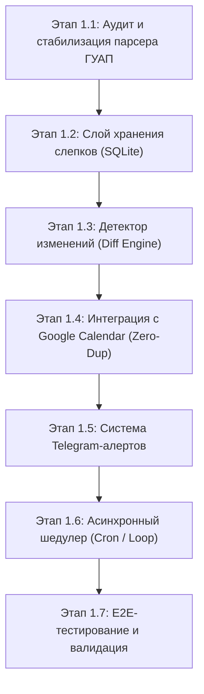
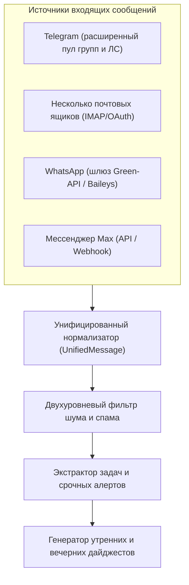
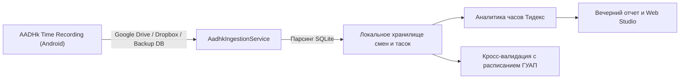

# Архитектурный план: Автономный AI-ассистент секретарь (Executive Chief of Staff)

## 1. Карта фичей первого уровня (High-Level Modules)

Система делится на 5 ключевых функциональных модулей:

| Модуль | Название | Ключевая ответственность |
| :--- | :--- | :--- |
| **M1** | **Часовой расписания и времени** (*Schedule Sentinel*) | Парсинг `guap.ru/rasp`, детекция любых изменений (аудитории, переносы, отмены), синхронизация с Google Calendar без дубликатов, алерты в Telegram. *(Реализован, активен)* |
| **M2** | **Омниканальный щит и брифы** (*Omnichannel Ingestion & Triage*) | Сбор входящего потока из Telegram (расширенный пул групп ГУАП и Тидекс), мессенджеров **WhatsApp** и **Max**, а также **нескольких почтовых ящиков** (ГУАП, Тидекс, личные). Интеллектуальная фильтрация спама, извлечение поручений и генерация утреннего (08:00) и вечернего (19:00) брифов. |
| **M3** | **Второй мозг, проекты и тайм-трекинг** (*Second Brain, Projects & Timesheet*) | Реестр проектов кафедры, грантов и задач сектора приборов «Тидекс». **Подключение БД мобильного приложения учета времени AADHk Time Recording** (`com.aadhk.time`): автоматический импорт SQLite, анализ отработанных часов в Тидекс, баланс времени и сопоставление с сеткой пар ГУАП. |
| **M4** | **Секретарь с правом черновика** (*Human-in-the-Loop & Drafts*) | Подготовка проектов ответов студентам/коллегам (в Telegram, WhatsApp, Max, Email); согласование любых внешних действий кнопками в Telegram: `[✅ Отправить]`, `[✏️ Изменить]`, `[❌ Отклонить]`. |
| **M5** | **Единый веб-кабинет** (*Web Executive Studio*) | Веб-интерфейс (`chat-app`): расписание, канбан проектов, таймшит отработанных часов Тидекс, архив дайджестов, просмотр документов и интерактивный диалог с ассистентом. |

---

## 2. Выбранный стартовый модуль: M1 «Часовой расписания и времени»

Модуль M1 выбран первым, так как:
1. Имеет наивысшую практическую ценность для преподавателя (мгновенное знание об изменениях аудиторий и расписания).
2. Обладает детерминированной входной и выходной логикой (без галлюцинаций LLM на старте).
3. Создает фундаментальный слой системы: работу с SQLite, планировщик задач, Telegram-нотификации и интеграцию с Google Calendar.

---

## 3. Детализированная декомпозиция Модуля M1 на микро-этапы

### Этап 1.1: Аудит и стабилизация парсера ГУАП (`ScheduleParser`)
- **Задача:** Гарантировать стабильное получение и разбор расписания преподавателя (ID `2903`).
- **Действия:**
  1. Проверить реальный HTML/JSON ответ `https://guap.ru/rasp/?pr=2903`.
  2. Обработать краевые случаи: перегрузка сайта, таймауты, пустые недели, сессионные блоки.
  3. Нормализовать сущности в строгие Pydantic-модели: дата, время начала/окончания, предмет, тип (лекция, практика, лаб), корпус, аудитория, группы.
  4. Реализовать вычисление детерминированного хэша слота (`slot_hash`) для однозначной идентификации занятия во времени и пространстве.
- **Критерий приемки (DoD):** Модульный тест парсера успешно разбирает живой и тестовый HTML в валидный список объектов `Lesson`.

---

### Этап 1.2: Слой хранения слепков (Snapshots Storage)
- **Задача:** Обеспечить персистентность истории расписания в SQLite без раздувания базы.
- **Действия:**
  1. Создать/проверить таблицы `content_snapshots` и `schedule_lessons` в SQLite (`assistant-core/data/assistant.db`).
  2. Сохранять общий хэш расписания (`payload_hash`). Если хэш не изменился — парсинг завершается без лишних операций ввода-вывода.
  3. Сохранять снимок занятий при обнаружении изменений для последующего анализа diff.
- **Критерий приемки (DoD):** При неизменном расписании новые записи в базу не дублируются; при изменении — сохраняется точный снапшот с таймстемпом.

---

### Этап 1.3: Детектор изменений расписания (`ScheduleDiffEngine`)
- **Задача:** Выявлять конкретные факты изменений между предыдущим и новым снимками.
- **Действия:**
  1. Реализовать классификацию типов изменений:
     - `NEW_LESSON` — добавлена новая пара.
     - `CANCELLED_LESSON` — пара отменена / удалена из сетки.
     - `ROOM_CHANGED` — изменение аудитории или корпуса (самый частый и критичный кейс).
     - `TIME_CHANGED` — перенос пары на другое время или день.
     - `GROUP_CHANGED` — смена потока/группы.
  2. Формировать структурированный объект события `DiffReport` с деталями («Было: ауд. 13-05 -> Стало: ауд. 22-14»).
- **Критерий приемки (DoD):** Тесты на сравнение двух слепков корректно определяют добавление, удаление и смену аудитории без ложных срабатываний.

---

### Этап 1.4: Интеграция с Google Calendar (Синхронизация без дубликатов)
- **Задача:** Вести календарь преподавателя в актуальном состоянии строго в режиме идемпотентности.
- **Действия:**
  1. Проверить валидность токена Google API (`token.json`, `credentials.json`) и логику автопродления (`refresh_token`).
  2. Вести таблицу маппинга `calendar_sync_records`: `slot_hash` ↔ `google_event_id`.
  3. Алгоритм синхронизации:
     - Новая пара → `events().insert()`.
     - Изменение аудитории/времени → `events().patch()`.
     - Отмена пары → `events().patch()` с префиксом `[ОТМЕНЕНО]` или безопасное удаление.
  4. Формирование карточки события: локация (корпус и аудитория), описание (группы, тип занятия).
- **Критерий приемки (DoD):** 10 последовательных запусков на одном расписании создают ровно 0 дубликатов в Google Календаре.

---

### Этап 1.5: Система оперативных Telegram-уведомлений (`ScheduleNotifier`)
- **Задача:** Мгновенно информировать преподавателя в личный чат Telegram при фиксации изменений.
- **Действия:**
  1. Оформить шаблоны алертов по стандартам:
     - 🚨 **Изменение в расписании ГУАП**
     - 📅 Дата: `Понедельник, 29 сентября`
     - 🕒 Время: `13:30 — 15:00`
     - 🏫 Было: `Лекция | Ауд. 13-05 (Гастелло)`
     - 📍 Стало: `Лекция | Ауд. 22-14 (Ленсовета)`
  2. Отправка через Telegram Bot API (`TELEGRAM_BOT_TOKEN`, `TELEGRAM_USER_ID`).
  3. Кнопка быстрого перехода к расписанию на сайте ГУАП.
- **Критерий приемки (DoD):** Изменение в тестовом сценарии мгновенно генерирует красивое форматированное сообщение в Telegram.

---

### Этап 1.6: Асинхронный шедулер периодического мониторинга
- **Задача:** Обеспечить автономную работу модуля 24/7 в фоне.
- **Действия:**
  1. Асинхронный цикл опроса с адаптивным интервалом:
     - Рабочие дни (07:00 — 21:00): проверка каждые 2 часа.
     - Ночь и воскресенье: спящий режим / проверка раз в 6 часов.
  2. Обработка сбоев: exponential backoff при недоступности сайта ГУАП (никаких падений демона).
  3. Защита от ложного сброса: если сайт вернул HTTP 500 / пустую страницу, старые пары НЕ помечаются отмененными.
- **Критерий приемки (DoD):** Демон работает в фоне, планово опрашивает расписание, корректно переживает обрыв сети.

---

### Этап 1.7: Комплексное E2E-тестирование и стабилизация
- **Задача:** Провести полную сквозную валидацию модуля перед переходом к Telegram-щиту (M2).
- **Действия:**
  1. Написать набор e2e-тестов на синтетических изменениях расписания.
  2. Проверить потребление ресурсов (память на VPS < 50 MB, CPU < 2%).
  3. Зафиксировать состояние в Git с документацией и инструкцией.
- **Критерий приемки (DoD):** Модуль M1 работает автономно, покрыт тестами, расписание синхронизируется с Google Calendar.

---

## 4. Детализированная декомпозиция Модуля M2: Омниканальный щит (Email, Telegram, WhatsApp, Max)

### Этап 2.1: Подключение нескольких почтовых ящиков (Multi-Mailbox Ingestion)
- **Задача:** Автоматический асинхронный мониторинг входящей корреспонденции без ручного разбора почты.
- **Подключаемые ящики:**
  1. Корпоративная почта ГУАП (вопросы студентов, распоряжения деканата, кафедры).
  2. Корпоративная/рабочая почта «Тидекс» (приборостроение, контрагенты, задачи сектора).
  3. Личные почтовые ящики (Gmail, Яндекс и др.).
- **Архитектура:**
  - Модуль `/opt/assistant-core/src/collector/email_collector.py`.
  - Протоколы: IMAP / OAuth2 с безопасным хранением учетных данных в `.env` (пароли приложений).
  - Фоновый опрос новых писем с сохранением метаданных (отправитель, тема, дата, приоритет, вложения).
  - Защита от дубликатов по `Message-ID`.

### Этап 2.2: Масштабирование пула групп и чатов Telegram
- **Задача:** Охватить все учебные потоки ГУАП и рабочие чаты «Тидекс» с динамическим управлением.
- **Действия:**
  1. Перевод списка источников из жесткого кода в динамическую таблицу SQLite (`monitored_sources`).
  2. Категоризация источников:
     - `guap_students`: потоки лекций, практик, лабораторных работ, чаты старост.
     - `guap_dept`: кафедра физики №1, объявления деканата.
     - `tydex_work`: проектные и производственные чаты сектора приборов.
  3. Настройка индивидуальных правил важности для каждой группы (например, в студенческих — поиск вопросов преподавателю, в кафедральных — дедлайны и приказы).

### Этап 2.3: Шлюзы мессенджеров WhatsApp и Max
- **Задача:** Консолидация входящих коммуникаций из WhatsApp и Max в единый контур секретаря.
- **Действия:**
  1. **WhatsApp Connector:** интеграция через REST/Webhook API (Green-API или локальный Baileys gateway) для получения сообщений от контактов, не пользующихся Telegram.
  2. **Max Connector:** интеграция с мессенджером Max (подключение бота/API вебхуков к корпоративному аккаунту).
  3. Нормализация всех входящих в модель `UnifiedMessage(source, sender, text, timestamp, reply_handle)`.

---

## 5. Детализированная декомпозиция Модуля M3: Интеграция БД учета времени AADHk Time Recording (`com.aadhk.time`)

### Этап 3.1: Коннектор и схема базы данных AADHk Time Recording
- **Задача:** Настроить регулярный импорт базы данных учета времени из мобильного приложения [AADHk Time Recording](https://play.google.com/store/apps/details?id=com.aadhk.time), где Дмитрий Александрович ведет учет часов по проектам «Тидекс».
- **Механизм доставки бэкапа:**
  1. *Вариант A (Автоматический):* Мониторинг папки резервных копий в Google Drive / Dropbox (куда приложение умеет автоматически сбрасывать SQLite файл при выходе).
  2. *Вариант B (Direct/Bot):* Возможность переслать файл базы `.db` боту в Telegram или загрузить через Web-кабинет (`chat-app`).
- **Парсер схемы SQLite AADHk:**
  - Разбор таблиц приложения: учетные записи времени (`time_records`), интервалы (check-in / check-out), привязанные проекты (`project`), задачи (`task`), заметки и перерывы.
  - Сохранение в унифицированную структуру `timesheet_records` в `/opt/assistant-core/data/assistant.db`.

### Этап 3.2: Аналитика трудозатрат «Тидекс» и кросс-валидация с ГУАП
- **Функционал:**
  1. **Трекинг нормы часов:** Автоматический подсчет отработанных часов за день, неделю и месяц по направлению «Тидекс».
  2. **Кросс-валидация:** Проверка на временные наложения между фактическими записями смен в Тидекс и парами в ГУАП (исключение коллизий в табелях).
  3. **Интеграция с вечерним дебрифингом:** Включение сводки трудозатрат в вечерний отчет («В Тидекс сегодня отработано: 4 ч 15 мин над задачей X»).
  4. **Экспорт и отчетность:** Формирование сводных отчетов для руководства сектора приборов в форматах Excel/PDF или Notion.

