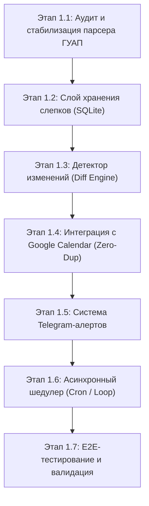

# Архитектурный план: Автономный AI-ассистент секретарь (Executive Chief of Staff)

## 1. Карта фичей первого уровня (High-Level Modules)

Система делится на 5 ключевых функциональных модулей:

| Модуль | Название | Ключевая ответственность |
| :--- | :--- | :--- |
| **M1** | **Часовой расписания и времени** (*Schedule Sentinel*) | Парсинг `guap.ru/rasp`, детекция любых изменений (аудитории, переносы, отмены), синхронизация с Google Calendar без дубликатов, алерты в Telegram. |
| **M2** | **Информационный щит и брифы** (*Telegram Triage & Briefs*) | Чтение чатов и каналов через MTProto (Telethon), двухуровневая фильтрация спама, выявление поручений и срочных тем, генерация утреннего (08:00) и вечернего (19:00) брифов. |
| **M3** | **Второй мозг и управление проектами** (*Second Brain & Projects*) | Реестр проектов кафедры, грантов и дипломников; автоматическое извлечение задач (Action Items); долгосрочная память договоренностей; контроль дедлайнов. |
| **M4** | **Секретарь с правом черновика** (*Human-in-the-Loop & Drafts*) | Подготовка проектов ответов студентам/коллегам; согласование любых внешних действий кнопками в Telegram: `[✅ Отправить]`, `[✏️ Изменить]`, `[❌ Отклонить]`. |
| **M5** | **Единый веб-кабинет** (*Web Executive Studio*) | Веб-интерфейс (`chat-app`): расписание, канбан проектов, архив дайджестов, просмотр документов и интерактивный диалог с ассистентом. |

---

## 2. Выбранный стартовый модуль: M1 «Часовой расписания и времени»

Модуль M1 выбран первым, так как:
1. Имеет наивысшую практическую ценность для преподавателя (мгновенное знание об изменениях аудиторий и расписания).
2. Обладает детерминированной входной и выходной логикой (без галлюцинаций LLM на старте).
3. Создает фундаментальный слой системы: работу с SQLite, планировщик задач, Telegram-нотификации и интеграцию с Google Calendar.

---

## 3. Детализированная декомпозиция Модуля M1 на микро-этапы

### Этап 1.1: Аудит и стабилизация парсера ГУАП (`ScheduleParser`)
- **Задача:** Гарантировать стабильное получение и разбор расписания преподавателя (ID `2903`).
- **Действия:**
  1. Проверить реальный HTML/JSON ответ `https://guap.ru/rasp/?pr=2903`.
  2. Обработать краевые случаи: перегрузка сайта, таймауты, пустые недели, сессионные блоки.
  3. Нормализовать сущности в строгие Pydantic-модели: дата, время начала/окончания, предмет, тип (лекция, практика, лаб), корпус, аудитория, группы.
  4. Реализовать вычисление детерминированного хэша слота (`slot_hash`) для однозначной идентификации занятия во времени и пространстве.
- **Критерий приемки (DoD):** Модульный тест парсера успешно разбирает живой и тестовый HTML в валидный список объектов `Lesson`.

---

### Этап 1.2: Слой хранения слепков (Snapshots Storage)
- **Задача:** Обеспечить персистентность истории расписания в SQLite без раздувания базы.
- **Действия:**
  1. Создать/проверить таблицы `content_snapshots` и `schedule_lessons` в SQLite (`assistant-core/data/assistant.db`).
  2. Сохранять общий хэш расписания (`payload_hash`). Если хэш не изменился — парсинг завершается без лишних операций ввода-вывода.
  3. Сохранять снимок занятий при обнаружении изменений для последующего анализа diff.
- **Критерий приемки (DoD):** При неизменном расписании новые записи в базу не дублируются; при изменении — сохраняется точный снапшот с таймстемпом.

---

### Этап 1.3: Детектор изменений расписания (`ScheduleDiffEngine`)
- **Задача:** Выявлять конкретные факты изменений между предыдущим и новым снимками.
- **Действия:**
  1. Реализовать классификацию типов изменений:
     - `NEW_LESSON` — добавлена новая пара.
     - `CANCELLED_LESSON` — пара отменена / удалена из сетки.
     - `ROOM_CHANGED` — изменение аудитории или корпуса (самый частый и критичный кейс).
     - `TIME_CHANGED` — перенос пары на другое время или день.
     - `GROUP_CHANGED` — смена потока/группы.
  2. Формировать структурированный объект события `DiffReport` с деталями («Было: ауд. 13-05 -> Стало: ауд. 22-14»).
- **Критерий приемки (DoD):** Тесты на сравнение двух слепков корректно определяют добавление, удаление и смену аудитории без ложных срабатываний.

---

### Этап 1.4: Интеграция с Google Calendar (Синхронизация без дубликатов)
- **Задача:** Вести календарь преподавателя в актуальном состоянии строго в режиме идемпотентности.
- **Действия:**
  1. Проверить валидность токена Google API (`token.json`, `credentials.json`) и логику автопродления (`refresh_token`).
  2. Вести таблицу маппинга `calendar_sync_records`: `slot_hash` ↔ `google_event_id`.
  3. Алгоритм синхронизации:
     - Новая пара → `events().insert()`.
     - Изменение аудитории/времени → `events().patch()`.
     - Отмена пары → `events().patch()` с префиксом `[ОТМЕНЕНО]` или безопасное удаление.
  4. Формирование карточки события: локация (корпус и аудитория), описание (группы, тип занятия).
- **Критерий приемки (DoD):** 10 последовательных запусков на одном расписании создают ровно 0 дубликатов в Google Календаре.

---

### Этап 1.5: Система оперативных Telegram-уведомлений (`ScheduleNotifier`)
- **Задача:** Мгновенно информировать преподавателя в личный чат Telegram при фиксации изменений.
- **Действия:**
  1. Оформить шаблоны алертов по стандартам:
     - 🚨 **Изменение в расписании ГУАП**
     - 📅 Дата: `Понедельник, 29 сентября`
     - 🕒 Время: `13:30 — 15:00`
     - 🏫 Было: `Лекция | Ауд. 13-05 (Гастелло)`
     - 📍 Стало: `Лекция | Ауд. 22-14 (Ленсовета)`
  2. Отправка через Telegram Bot API (`TELEGRAM_BOT_TOKEN`, `TELEGRAM_USER_ID`).
  3. Кнопка быстрого перехода к расписанию на сайте ГУАП.
- **Критерий приемки (DoD):** Изменение в тестовом сценарии мгновенно генерирует красивое форматированное сообщение в Telegram.

---

### Этап 1.6: Асинхронный шедулер периодического мониторинга
- **Задача:** Обеспечить автономную работу модуля 24/7 в фоне.
- **Действия:**
  1. Асинхронный цикл опроса с адаптивным интервалом:
     - Рабочие дни (07:00 — 21:00): проверка каждые 2 часа.
     - Ночь и воскресенье: спящий режим / проверка раз в 6 часов.
  2. Обработка сбоев: exponential backoff при недоступности сайта ГУАП (никаких падений демона).
  3. Защита от ложного сброса: если сайт вернул HTTP 500 / пустую страницу, старые пары НЕ помечаются отмененными.
- **Критерий приемки (DoD):** Демон работает в фоне, планово опрашивает расписание, корректно переживает обрыв сети.

---

### Этап 1.7: Комплексное E2E-тестирование и стабилизация
- **Задача:** Провести полную сквозную валидацию модуля перед переходом к Telegram-щиту (M2).
- **Действия:**
  1. Написать набор e2e-тестов на синтетических изменениях расписания.
  2. Проверить потребление ресурсов (память на VPS < 50 MB, CPU < 2%).
  3. Зафиксировать состояние в Git с документацией и инструкцией.
- **Критерий приемки (DoD):** Модуль M1 работает автономно, покрыт тестами, расписание синхронизируется с Google Calendar.
