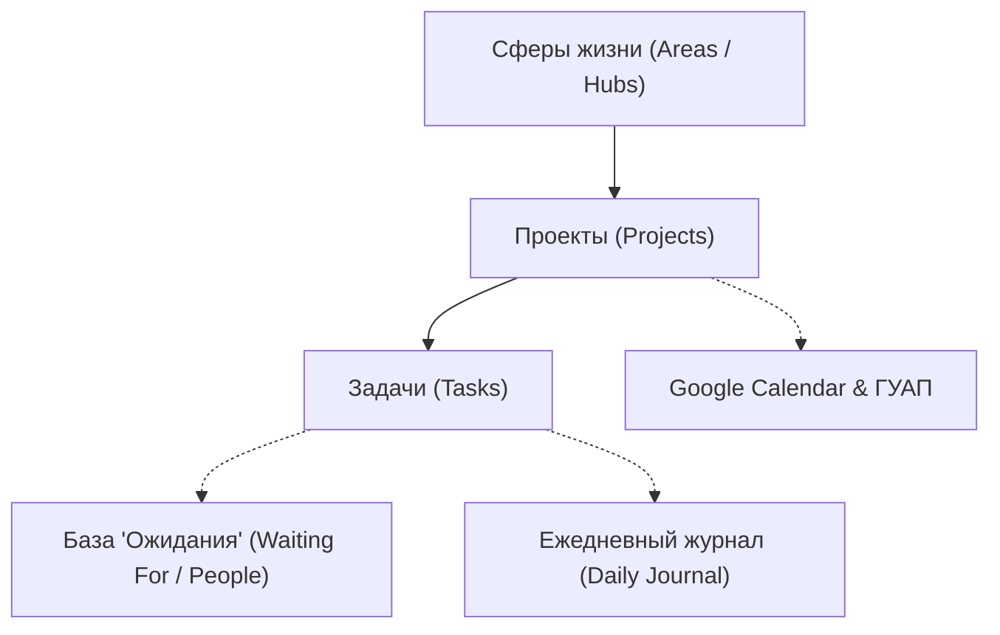

# Спецификация: Голосовой AI-секретарь и Второй мозг в Notion (Voice-First Second Brain)

## 1. Концепция и философия системы

### 1.1. Проблема классического тайм-менеджмента («Порочный двухнедельный круг»)
Попытки вести дела через Todoist, блокноты, классический Notion или GTD неизбежно сталкиваются с непреодолимым **ручным трением**:
1. **Забывание:** задачи приходят на созвонах, на ходу, в Telegram-переписках; записать их руками сразу неудобно, и они теряются.
2. **Высокая когнитивная нагрузка:** регулярный разбор 100–200 задач требует 30–60 минут в день, которых у практикующего преподавателя и разработчика нет.
3. **Психологический ступор:** вид перегруженного списка задач по утрам вызывает стресс, переключая в режим «интуитивного пожаротушения».
4. **Коллапс системы:** через 2 недели активного ведения наступает выгорание, система забрасывается на месяц до накопления критического хаоса.

### 1.2. Решение: Voice-First Autonomous Chief of Staff
Ассистент полностью берет на себя рутину сбора, классификации, структурирования и напоминания задач.
- **Интерфейс ввода — голос:** надиктовать 3 минуты мыслей вслух в Telegram в 5–10 раз быстрее и проще, чем печатать.
- **Принцип «Ассистент думает за тебя»:** утром выдается не простыня из 200 задач, а ровно **3–4 ключевые задачи дня** + список мелких обязательств.
- **Единое центральное хранилище — Notion:** все сферы, проекты, задачи и протоколы встреч ведутся в структурированных связанных базах данных, доступных с любого устройства.

---

## 2. Архитектура данных в Notion: Трехуровневая модель



### Уровень 1: Сферы жизни (Areas)
Высший уровень классификации контекста:
1. **ГУАП (Кафедра 3):** учебный процесс, лекции, лабы, расписание, дипломники, методическая работа, деканат.
2. **AI & Dev Projects:** разработка ассистента (`chat-app`, `assistant-core`), коммерческие проекты, архитектура.
3. **Наука и публикации:** статьи (ВАК, Scopus), конференции, гранты, НИР.
4. **Личное и семья:** здоровье, спорт, быт, семья, личные цели.
5. **Финансы:** учет расходов, налоги, выплаты, бюджеты проектов.
6. **Ожидания / Контроль поручений:** делегированные задачи, за которыми нужно проследить.

### Уровень 2: База данных «Проекты» (`Projects DB`)
Свойства карточки проекта:
- `Name` (Title): Название проекта (например, *«Разработка модуля Notion для AI-секретаря»*).
- `Area` (Select): Сфера жизни.
- `Status` (Status): *Backlog*, *Active*, *Paused*, *Completed*.
- `Target Date` (Date): Целевой дедлайн проекта.
- `Key Result` (Text): Ожидаемый результат.
- `Tasks Relation` (Relation): Связь с задачами проекта.

### Уровень 3: База данных «Задачи» (`Tasks DB`)
Атомарные конкретные действия:
- `Task` (Title): Формулировка действия с глагола (*«Отправить план диплома Иванову»*).
- `Project` (Relation): Проект, к которому относится задача.
- `Status` (Status): *To Do*, *In Progress*, *Waiting*, *Done*, *Archived*.
- `Priority` (Select): *P1 (Фокус дня)*, *P2 (Важно)*, *P3 (Бытовое/Мелкое)*.
- `Due Date` (Date): Срок выполнения.
- `Estimated Minutes` (Number): Оценка времени (15 мин, 1 час и т.д.).
- `Context / Tags` (Multi-select): *ГУАП*, *Код*, *Звонок*, *За компьютером*, *Купить*.

### Дополнительная база: «Ожидания и Люди» (`People & Waiting For DB`)
Критический инструмент для контроля внешних договоренностей:
- `What` (Title): Что ожидается от человека (*«Отчет по лабораторной №2»*).
- `Person` (Text / Relation): Кто должен сделать (*«Староста группы 431», «Дипломник Смирнов»*).
- `Context / Project` (Relation): Связанный проект.
- `Check Date` (Date): Когда спросить / напомнить.
- `Status` (Status): *Waiting*, *Received*, *Overdue*.

### Дополнительная база: «Ежедневный журнал» (`Daily Journal DB`)
- `Date` (Date / Title): `YYYY-MM-DD`.
- `Done Summary` (Text): Что фактически сделано за день по итогам вечернего войса.
- `Key Insights` (Text): Мысли, идеи, рефлексия дня.
- `Raw Voice Transcript` (Text): Исходная расшифровка вечерней заметки.

---

## 3. Сценарии взаимодействия (Workflows)

### Сценарий 1: ☀️ Утренний фокус (Morning Briefing)
- **Триггер:** 08:00 утра (автопуш) или команда `/today` / «Что у меня сегодня?».
- **Логика сборки:**
  1. Из `Schedule Sentinel`: сегодняшние пары преподавателя в ГУАП (время, предмет, аудитория, группа).
  2. Из `Google Calendar`: личные встречи, созвоны, события.
  3. Из `Notion Tasks DB`: задачи со статусом *In Progress* или с дедлайном на сегодня; фильтрация ровно **3–4 главных задач (P1)**.
  4. Из `Notion Waiting For`: напоминания («Сегодня нужно спросить у X отчет Y»).
  5. Список мелких рутинных дел (P3).
- **Результат:** Емкая, легко читаемая карточка в Telegram без информационной перегрузки.

### Сценарий 2: 🎙️ Вечерняя рефлексия (Evening Voice Debrief)
- **Триггер:** Голосовое сообщение перед сном (2–4 минуты).
- **Пользователь говорит:**
  > «Сегодня провел лабы у 3-й кафедры, закрыли тему по процессам. По коду доделал Whisper и добавил хэндлер документов. Завтра нужно не забыть заехать в отдел кадров подписать приказ. Также поговорил с дипломником Колей — обещал прислать введение к четвергу, нужно будет проверить в пятницу утром».
- **Действия ассистента:**
  1. Whisper (STT) расшифровывает голос в текст.
  2. LLM анализирует транскрипт и декомпозирует сущности:
     - Завершенные дела ➔ находит и переводит в `Done` в Notion.
     - Новая задача на завтра ➔ создает задачу *«Заехать в отдел кадров подписать приказ»* (P1/P2) с датой завтра.
     - Договоренность ➔ создает запись в `Waiting For`: *«Проверить введение диплома»*, Ответственный: *Коля*, Check Date: *пятница*.
     - Итог дня ➔ сохраняет запись в `Daily Journal`.
  3. Ассистент отправляет красивый Telegram-отчет с подтверждением всех внесенных изменений.

### Сценарий 3: ⚡ Захват на лету (On-the-go Voice Capture)
- **Триггер:** Короткое голосовое сообщение или текст в течение дня («Напомни в среду в 14:00 созвониться с деканатом», «Пришла идея добавить экспорт расписания в iCal»).
- **Действия ассистента:**
  - Если содержит конкретную дату и время встречи ➔ создает событие в `Google Calendar`.
  - Если идея/задача ➔ парсит проект и создает карточку в `Notion Tasks`.

### Сценарий 4: 🎧 Разбор созвонов и встреч (Meeting Deconstruction)
- **Триггер:** Пользователь отправляет аудиозапись созвона (Zoom, диктофон) или текстовую транскрипцию через Telegram.
- **Действия ассистента:**
  1. Whisper обрабатывает длинное аудио (сплит по чанкам при необходимости).
  2. Модель извлекает протокол встречи:
     - Резюме обсуждения (5–7 предложений).
     - Принятые решения.
     - Action Items (с матрицей: *Кто*, *Что*, *Срок*).
  3. Автоматическое распределение поручений в базу `Waiting For` и создание задач по проектам.

### Сценарий 5: 🔍 Контекстный брифинг («Что обсудить с...»)
- **Триггер:** Сообщение боту: *«Иду на встречу с [Имя/Должность]»* или *«Что у нас по проекту [Название]?»*.
- **Действия ассистента:**
  - Фильтрует базы Notion по человеку или проекту.
  - Мгновенно выдает сводку: нерешенные вопросы, просроченные дедлайны, предыдущие договоренности.

---

## 4. Архитектурная интеграция в кодовую базу

```
/opt/assistant-core/
├── src/
│   ├── brain/
│   │   ├── voice.py              # STT (Groq Whisper + local faster-whisper)
│   │   ├── debrief_parser.py     # Анализатор вечерних отчетов и встреч (LLM)
│   │   └── context_brief.py      # Генератор утренних и контекстных сводок
│   ├── connectors/
│   │   ├── notion/               # Модуль интеграции с Notion API
│   │   │   ├── client.py         # Асинхронный клиент Notion API (httpx / notion-client)
│   │   │   ├── schema.py         # Схема баз данных (Projects, Tasks, Waiting, Journal)
│   │   │   └── sync.py           # Методы CRUD для задач, проектов и журнала
│   │   ├── google_calendar.py    # Существующий Google Calendar Sync
│   │   └── guap_rasp.py          # Существующий Schedule Sentinel
│   └── bot/ / dev-bridge/        # Прием войсов, документов и интерактивные отчеты
```

---

## 5. Дорожная карта внедрения (Roadmap)

| Этап | Задача | Результат | Статус |
| :--- | :--- | :--- | :--- |
| **0** | **STT-пайплайн (Whisper + Groq)** | Автономное распознавание голосовых сообщений и аудиофайлов без Gemini 503 ошибок. | ✅ Завершено |
| **0.1** | **Поддержка файлов в боте** | Прием `.txt`, `.md`, документов и аудиозаписей в Telegram-боте. | ✅ Завершено |
| **1** | **Notion Connector & Схема данных** | Создание Notion Integration, шаблонов баз данных (`Projects`, `Tasks`, `Waiting`, `Journal`), CRUD API. | ⏳ В очереди |
| **2** | **Движок вечерней рефлексии** | Алгоритм обработки вечернего войса: автоматическое закрытие и создание задач в Notion. | ⏳ В очереди |
| **3** | **Утренний фокус-дайджест** | Синтез данных: Расписание ГУАП + Google Calendar + Топ-3 задачи Notion. | ⏳ В очереди |
| **4** | **Разбор созвонов и аудиофайлов** | Автоматическое формирование протоколов встреч и матриц поручений по участникам. | ⏳ В очереди |
| **5** | **Контекстные запросы** | Поиск по людям и проектам перед встречами («Что обсудить с X?»). | ⏳ В очереди |
